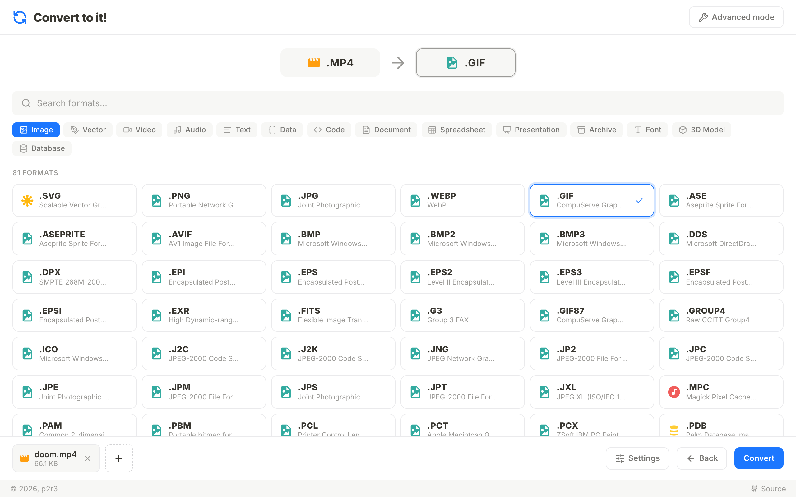
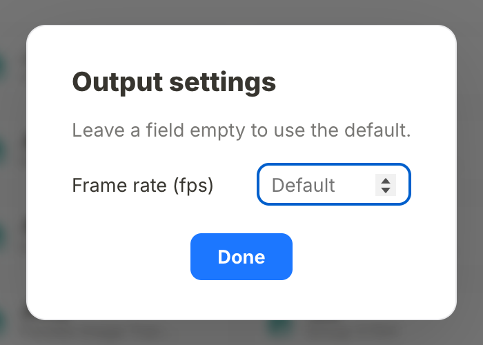
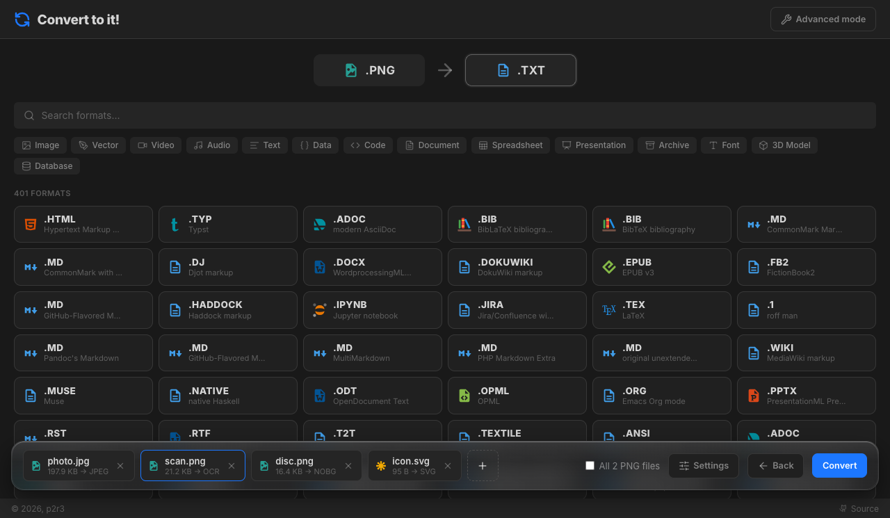
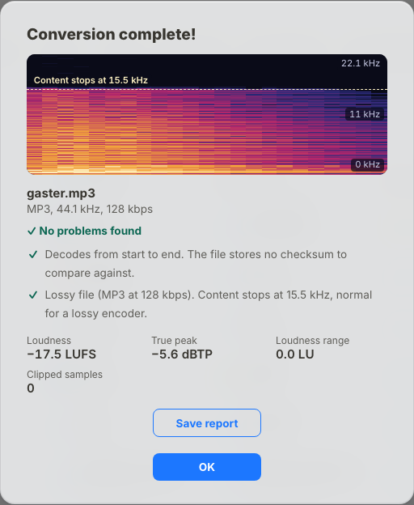

<div align="center">


# [Convert to it!](https://convert.to.it/)

**Truly universal online file converter.**

[What this fork adds](#what-this-fork-adds) · [Usage](#usage) · [Run it yourself](#deployment) · [Contributing](#contributing) · [Acknowledgements](#acknowledgements)


[](https://github.com/p2r3/convert)


<picture>
  <source media="(prefers-color-scheme: dark)" srcset="docs/screenshot-dark.png">
  
</picture>

</div>

Many online file conversion tools are **boring** and **insecure**. They only allow conversion between two formats in the same medium (images to images, videos to videos, etc.), and they require that you _upload your files to some server_.

This is not just terrible for privacy, it's also incredibly lame. What if you _really_ need to convert an AVI video to a PDF document? Try to find an online tool for that, I dare you.

[Convert.to.it](https://convert.to.it/) aims to be a tool that "just works". You're almost _guaranteed_ to get an output - perhaps not always the one you expected, but it'll try its best to not leave you hanging.

For a semi-technical overview of this tool, check out the video: https://youtu.be/btUbcsTbVA8

## What this fork adds

This is a fork of [p2r3/convert](https://github.com/p2r3/convert). The rest of this README is the original project's, apart from the notes that mention the fork. [CHANGELOG.md](CHANGELOG.md) lists every changed file.



- **Per-conversion output settings.** A Settings button next to Convert offers the options that fit the chosen format: image quality, frame rate, video and audio bitrate, longest side, start and end time, and removing metadata. Leave a field empty to use the default.
- **Better GIFs.** GIF output from the FFmpeg handler generates its palette in a first pass and uses it in a second.
- **Adding files to a selection that is already open.**

<br clear="right">



- **A different output for every file.** Files of different types can be added together. Click a file in the bar to choose its output. A choice applies to all files of that type unless you untick "All files".
- **One download.** Several outputs arrive as one zip, built with [zip.js](https://github.com/gildas-lormeau/zip.js). A password in Settings encrypts it with AES-256.
- **Compress.** Converts a file to its own format and makes it smaller: JPEG, WebP and AVIF are re-encoded, PNG is optimised without changing a pixel (with OxiPNG, the codec of [Squoosh](https://github.com/GoogleChromeLabs/squoosh)), PDF is recompressed and its photos re-encoded, video and audio are transcoded, and SVG, HTML, CSS, JavaScript and JSON are minified. If the result is not smaller, you get the original back.
- **Four new outputs.** "Recognised text (OCR)" reads English and Dutch text from images and PDF pages, "PNG with background removed" cuts out the subject of an image, "Merged PDF" joins the selected PDFs in the order of the file bar, and "PDF pages" writes every page as a PDF of its own.
- **PDF pages and rotation.** With a PDF as input and PDF as output, Settings has "Pages to keep" (such as `2-5,8`, in the order you write them) and "Rotate pages". Bookmarks and form fields are kept. The tools follow those of [Stirling-PDF](https://github.com/Stirling-Tools/Stirling-PDF) and run on mupdf.
- **Cutting without re-encoding.** With a video or audio file and its own format as output, "Cut without re-encoding" in Settings copies the streams between the start and end time, the way [LosslessCut](https://github.com/mifi/lossless-cut) does. It takes a fraction of the time and loses no quality.
- **Liquid glass.** The action bar is a pane of glass that floats over the format list, and dialogs are glass sheets. The material comes from [LiquidGlass UI](https://github.com/hwyuanzi/LiquidGlass-UI). The action bar bends what is behind it at its edges and splits the colours slightly there, an effect of [Liquid Glass Studio](https://github.com/iyinchao/liquid-glass-studio).
- **More formats.** 3D models (STL, PLY, FBX, 3MF, Collada, 3DS and USDZ in; GLB, glTF, OBJ, STL, PLY and USDZ out) with the loaders of three.js. Subtitles (SRT, WebVTT and ASS). Spreadsheets (XLS, XLSX, ODS and CSV, in both directions) with [SheetJS](https://sheetjs.com/). Outlook messages (MSG to EML or text) and vCard contacts (to JSON, and from there to CSV). And about 65 image formats that ImageMagick could read all along but that were hidden, among them the raw files of Canon, Nikon, Sony, Fuji and other cameras. The list of what was missing came from [ConvertX](https://github.com/C4illin/ConvertX).
- **Upscaling.** Four outputs double the size of an image or a video on the graphics card, with the networks of [WebSR](https://github.com/sb2702/websr): "Photo, upscaled 2×" and "Drawing, upscaled 2×" as PNG, and "Film, upscaled 2×" and "Animation, upscaled 2×" as MP4. Video goes frame by frame through mediabunny, as in [Upscaler Studio](https://github.com/avelinocarloscorrea/upscaler-studio), and keeps its sound.
- **A Tools row.** Above the list of 447 formats, the outputs that are tools and not formats get a button of their own, for the files they fit: "Read text (OCR)", "Remove background" and "Combine into one PDF" for images, "Upscale 2×" for images and video, "Contact sheet" for video, "Check audio" and "Make a video" for audio, "Split into pages" and "Merge PDFs" for PDFs. Help describes them, and Compress and Settings.
- **A double-click start.** `start.command` builds the app when the build is missing or older than the source, serves it on `http://localhost:4319` and opens the browser. `bun run start` does the last two anywhere. Opened straight from disk, `index.html` now says why that cannot work.
- **A Content Security Policy.** The build keeps the page to its own origin: an HTML, SVG or EPUB that you convert cannot load a tracking image or send anything out, and script inside it does not run.
- **Less waiting.** The first conversion that uses FFmpeg no longer spends about six seconds listing its formats, and the development server uses the format cache. A conversion no longer stands still while its tab is in the background, except the two that draw with the page itself: rendering a presentation, and HTML to SVG.
- **Threads.** On a page that is cross-origin isolated, H.264 encoding, background removal and PNG compression use several cores. On a ten-core laptop an 8-second 720p clip encodes in 3.1 seconds instead of 11.5, and a background is removed in 0.9 seconds instead of 2.5. The development server, the Docker image and the desktop app send the two headers this needs. On GitHub Pages, which cannot, [coi-serviceworker](https://github.com/gzuidhof/coi-serviceworker) adds them.



- **Check audio.** A tool for music files that runs audiocheck (my audio checker, not published yet): it finds lossy files sold as lossless, fake hi-res, clipping and damage, and measures loudness and true peak (EBU R128). The result dialog shows the spectrogram with the frequency where the content stops, the verdict and the numbers; "Save report" downloads it as an HTML page that works offline.
- **Audio edits.** For audio output, Settings can even out loudness to −14 LUFS, fade in and out, mix down to mono, play backwards, cut silence at the start and end, and change the speed without changing the pitch. The ideas come from [AudioMass](https://github.com/pkalogiros/AudioMass) and [audiosaw](https://github.com/andrewnakas/audiosaw); FFmpeg's filters do the work.
- **More for PDFs.** For a PDF that stays a PDF, Settings can open a protected file with its password (the result has none), protect the result with a password (AES-256), number the pages and print a watermark across them. "Combine into one PDF" puts two or more pictures on pages of their own size. The list of tools follows [PDFCraft](https://github.com/PDFCraftTool/pdfcraft) and [pdfToPng](https://github.com/Durgeshwar-AI/pdfToPng).
- **Smaller PNGs.** A "Colours" setting turns a PNG into a palette image of 2 to 256 colours with dithering and then optimises it with OxiPNG, the chain of [limitPNG](https://github.com/nullice/limitPNG). Compress shows the size before and after, and keeps the original when it is smaller.
- **Video tools.** "Contact sheet" lays 16 evenly spaced stills of a video out in one PNG. "Make a video" turns a song into an MP4 that shows its cover art, or a waveform if it has none. Found by going through [awesome-video](https://github.com/krzemienski/awesome-video).

<br clear="right">

<details>
<summary>Limits of these additions</summary>

- The output settings are read by six of the conversion tools (FFmpeg, mediabunny, ImageMagick, the browser canvas and the two PDF tools). When a conversion ends in another tool, the result popup says the settings were not applied. That includes Compress on a PNG, which keeps the metadata and the size. The page and rotation settings are only offered where they work: for a PDF that stays a PDF, and for "PDF pages".
- Background removal uses silueta, a U2-Net reduced to 44 MB. It works well on clear subjects and is rough on hair and fine edges. Its first use downloads about 58 MB.
- OCR downloads about 10 MB on first use. A PDF with several pages gives one text file per page.
- Windows Explorer and macOS Archive Utility cannot open AES-encrypted zips; 7-Zip and Keka can.
- Compress has no effect on formats that are already compressed, such as ZIP.
- Compress on a PDF re-encodes its photos as JPEG at quality 70 unless you set another. Images with transparency, CMYK or indexed colour are left as they are, and no image is scaled down. Choosing pages or a rotation without setting a quality leaves the images untouched.
- A cut without re-encoding starts at the keyframe before the start time, so it can begin a little early. It only applies when the output has the input's format.
- Upscaling needs WebGPU, which Chrome, Edge, Brave and Safari 26 have; elsewhere the conversion fails and says why. An image or a frame can be at most half the texture limit of the graphics card on each side, usually 4096 pixels. The weights for photos are weaker than those for animation, by their author's own account.
- 3D models keep their meshes, materials and the textures stored inside the file. Textures in separate files are left out, and animations are not carried over.
- Subtitles lose the styling of ASS when they become SRT or WebVTT.
- Spreadsheets keep values and formulas, not fonts, colours, charts or pictures. A workbook with several sheets becomes one CSV per sheet. Non-Western text in workbooks older than Excel 97 can come out wrong.
- An Outlook message keeps its attachments, except other messages attached to it. A body written in rich text comes out as plain text. vCard values in the quoted-printable encoding of version 2.1 are not decoded.
- Camera raw files are developed with LibRaw's defaults.
- Because of that policy, an HTML, SVG or EPUB that points at images or fonts on the internet is converted without them. The policy covers the page, not the worker that most conversion tools run in; the worker draws nothing that a file could script.
- A conversion that fails tries other routes before it gives up, which can take a while. The popup then shows the error of the first route. Cancel stops the search.
- WebM from FFmpeg is VP8: the VP9 encoder of its WebAssembly build crashes. mediabunny, which is tried first for most video, is not affected.
- FFmpeg uses threads for MP4, MOV and MKV output only. Its multithreaded build hangs with some other encoders, VP9 among them, so those stay on one thread; if it stops responding all the same, the conversion starts again without threads.
- The service worker reloads the page once on the first visit, and is not installed on localhost.
- Check audio needs the browser's own decoder, so it reads what the browser can play. Brave Shields changes decoded audio slightly against fingerprinting, which turns off the bit-depth and checksum checks; the report says so. Formats other than MP3, FLAC, WAV, Ogg, M4A, AAC and AIFF are converted to WAV first, which hides their original encoding.
- Audio edits apply to audio output only, not to the sound of a video. Fades at the end and cutting silence at the end hold the whole decoded file in memory, about 500 MB for an hour of stereo.
- Page numbers and watermarks use Helvetica, so characters outside Latin-1 print as "?". On a page that a PDF turns with /Rotate they are placed as if it were upright. A PDF password can't contain a comma or an equals sign.
- "Make a video" with a waveform encodes every frame and takes a while for a long song.
- The glass bends what is behind it at its edges, and shows the colour fringe, only in Chromium-based browsers. Firefox and Safari show the frosted pane without that. With "reduce transparency" switched on in the system settings, the panes are opaque.

</details>

## Usage

1. Go to [convert.to.it](https://convert.to.it/). That is the original project's hosted version; to use this fork's additions, [run it yourself](#deployment). On a Mac with [Bun](https://bun.sh/) installed, that is a double-click on `start.command`.
2. Click the big box to add your file (or just drag it on to the window).
3. An input format should have been automatically selected (as shown at the top). If not, yikes! Try pressing "Show all" and searching for it, or if it's really not there, see the "Issues" section below.
4. Press "Next" and select your output format.
5. Click **Convert**!
6. Hopefully, after a bit (or a lot) of thinking, the program will spit out the file you wanted. If not, see the "Issues" section below.

## Issues

Ever since the YouTube video released, we've been getting spammed with issues suggesting the addition of all kinds of niche file formats. To keep things organized, I've decided to specify what counts as a valid issue and what doesn't.

> [!IMPORTANT]
> **SIMPLY ASKING FOR A FILE FORMAT TO BE ADDED IS NOT A MEANINGFUL ISSUE!**

There are thousands of file formats out there. It can take hours to add support for just one. The math is simple - we can't possibly support every single file. As such, simply listing your favorite file formats is not helpful. We already know that there are formats we don't support, we don't need tickets to tell us that.

When suggesting a file format, you must _at minimum_:

- Make sure that there isn't already an issue about the same thing, and that we don't already support the format.
- Explain what you expect the conversion to be like (what medium is it converting to/from). It's important to note here that simply parsing the underlying data is _not sufficient_. Imagine if we only treated SVG images as raw XML data and didn't support converting them to raster images - that would defeat the point. In other words, try to avoid crude "binary waterfalls".
- Provide links to existing browser-based solutions if possible, or at the very least a reference for implementing the format, and make sure the license is compatible with GPL-2.0.

If this seems like a lot, please remember - a developer will have to do 100x more work to actually implement the format. Doing a bit of research not only saves them precious time, it also weeds out "unserious" proposals that would only bloat our to-do list.

**If you're submitting a bug report,** you only need to do step 1 - check if the problem isn't already reported by someone else. Bug reports are generally quite important otherwise.

Though please note, "converting X to Y doesn't work" is **not** a bug report. However, "converting X to Y works but not how I expected" likely **is** a bug report.

## Deployment

### Just using it

Install [Bun](https://bun.sh/), then double-click `start.command` (macOS) or run:

```bash
bun install
bun run build && bun run cache:build
bun run start
```

The app opens at `http://localhost:4319`. Opening `index.html` or `dist/index.html` from the file manager does not work: a page at a `file://` address may not load its own scripts, workers and WebAssembly.

### Local development (Bun + Vite)

1. Clone this repository.
2. Install [Bun](https://bun.sh/).
3. Run `bun install` to install dependencies.
4. Run `bun run dev` to prepare and start the development server.

_The following steps are optional, but recommended for performance:_

When you first open the page, it'll take a while to generate the list of supported formats for each tool. If you open the console, you'll see it complaining a bunch about missing caches.

You can generate this list beforehand and save it into `dist/` by running `bun run cache:build` after `bun run build`. If you run into issues where your changes seem to not be applying, try deleting `dist/cache.json`.

In this fork the development server also uses `dist/cache.json` when it exists, so `bun run dev` starts as fast as a build. A handler that is not in the cache yet is still picked up; after changing the formats of an existing handler, delete the file or run `bun run cache:build` again.

### Docker (prebuilt image)

> [!NOTE]
> The prebuilt image is the original project's and does not have this fork's additions. For those, use the [local build](#docker-local-build-for-development) below.

Docker compose files live in the `docker/` directory, so run compose with `-f` from the repository root:

```bash
docker compose -f docker/docker-compose.yml up -d
```

Alternatively download the `docker-compose.yml` separately and start it by executing `docker compose up -d` in the same directory.

This runs the container on `http://localhost:8080/convert/`.

### Docker (local build for development)

Use the override file to build the image locally:

```bash
docker compose -f docker/docker-compose.yml -f docker/docker-compose.override.yml up --build -d
```

The first Docker build is expected to be slow because Chromium and related system packages are installed in the build stage (needed for puppeteer in `buildCache.js`). Later builds are usually much faster due to Docker layer caching.

### Manual

Run `bun run build` and then `bun run cache:build`. Then serve the `dist/` folder on any HTTP server of your choice.

In this fork, conversions use several threads when the page is cross-origin isolated. A server does that by sending `Cross-Origin-Opener-Policy: same-origin` and `Cross-Origin-Embedder-Policy: require-corp` with every file, as `docker/nginx/default.conf` does. On a host where you cannot set headers, a service worker in the build adds them after the first page load.

## Acknowledgements

Some features were inspired by other open source converters. The ideas were reimplemented here; no code was copied.

- [VERT](https://github.com/VERT-sh/VERT): per-conversion output settings.
- [CompressZ](https://github.com/ADJ189/CompressZ): two-pass GIF palette generation and bundling multiple outputs into one zip.
- [Arachnidium](https://github.com/p2r3/Arachnidium): minifying web formats and keeping the original when the result is not smaller.
- [Stirling-PDF](https://github.com/Stirling-Tools/Stirling-PDF): splitting, compressing and rotating PDFs and extracting pages.
- [LosslessCut](https://github.com/mifi/lossless-cut): cutting video and audio by copying the streams.
- [Liquid Glass Studio](https://github.com/iyinchao/liquid-glass-studio) by Charles Yin: the colour dispersion at the edge of the glass.
- [ConvertX](https://github.com/C4illin/ConvertX): its format lists showed which formats were missing here. It converts on a server with native programs, so the conversions themselves are built on other libraries.
- [Upscayl](https://github.com/upscayl/upscayl), [Enhance](https://github.com/addyosmani/enhance) and [Upscaler Studio](https://github.com/avelinocarloscorrea/upscaler-studio): upscaling images and video in the browser.
- [background-removal-js](https://github.com/imgly/background-removal-js) by IMG.LY: the reason for the larger background removal model. Its code and models are not included, because its AGPL-3.0 licence cannot be combined with this project's.
- [audiosaw](https://github.com/andrewnakas/audiosaw) and [AudioMass](https://github.com/pkalogiros/AudioMass): the audio edits. audiosaw is AGPL-3.0, so none of its code is included.
- [PDFCraft](https://github.com/PDFCraftTool/pdfcraft) and [pdfToPng](https://github.com/Durgeshwar-AI/pdfToPng): the PDF password, page number, watermark and pictures-to-PDF tools. PDFCraft is AGPL-3.0, so none of its code is included.
- [limitPNG](https://github.com/nullice/limitPNG): reducing the colours of a PNG before optimising it, and showing the size before and after.
- [awesome-video](https://github.com/krzemienski/awesome-video): the list where the contact sheet and the song-to-video tool were found.

The additions also use these projects:

| Project                                                                                                                                                                                                                                                                      | Used for                               | Licence              |
| ---------------------------------------------------------------------------------------------------------------------------------------------------------------------------------------------------------------------------------------------------------------------------- | -------------------------------------- | -------------------- |
| [zip.js](https://github.com/gildas-lormeau/zip.js) by Gildas Lormeau                                                                                                                                                                                                         | Zip download and encryption            | BSD-3-Clause         |
| [SVGO](https://github.com/svg/svgo)                                                                                                                                                                                                                                          | SVG minification                       | MIT                  |
| [html-minifier-terser](https://github.com/terser/html-minifier-terser) and [terser](https://github.com/terser/terser)                                                                                                                                                        | HTML and JavaScript minification       | MIT, BSD-2-Clause    |
| [tesseract.js](https://github.com/naptha/tesseract.js) and [Tesseract](https://github.com/tesseract-ocr/tesseract)                                                                                                                                                           | OCR                                    | Apache-2.0           |
| [ONNX Runtime](https://github.com/microsoft/onnxruntime)                                                                                                                                                                                                                     | Running the background removal model   | MIT                  |
| [silueta](https://github.com/xuebinqin/U-2-Net/issues/295), a reduced [U2-Net](https://github.com/xuebinqin/U-2-Net), model file from [rembg](https://github.com/danielgatis/rembg)                                                                                          | Background removal model               | See [NOTICE](NOTICE) |
| [jSquash](https://github.com/jamsinclair/jSquash) OxiPNG, the codec of [Squoosh](https://github.com/GoogleChromeLabs/squoosh)                                                                                                                                                | PNG compression                        | Apache-2.0           |
| [WebSR](https://github.com/sb2702/websr) by Sam Bhattacharyya, with the networks of [Anime4K](https://github.com/bloc97/Anime4K)                                                                                                                                             | Upscaling                              | MIT                  |
| [SheetJS Community Edition](https://git.sheetjs.com/sheetjs/sheetjs)                                                                                                                                                                                                         | Spreadsheets                           | Apache-2.0           |
| [msgreader](https://github.com/HiraokaHyperTools/msgreader)                                                                                                                                                                                                                  | Reading Outlook messages               | Apache-2.0           |
| [coi-serviceworker](https://github.com/gzuidhof/coi-serviceworker) by Guido Zuidhof                                                                                                                                                                                          | Cross-origin isolation on static hosts | MIT                  |
| [ffmpeg.wasm](https://github.com/ffmpegwasm/ffmpeg.wasm) multithreaded core                                                                                                                                                                                                  | Faster H.264 encoding                  | GPL-2.0-or-later     |
| [LiquidGlass UI](https://github.com/hwyuanzi/LiquidGlass-UI) by Hollan Yuan                                                                                                                                                                                                  | Glass action bar and dialogs           | MIT                  |
| audiocheck (not published yet), with [music-metadata](https://github.com/Borewit/music-metadata), [fft.js](https://github.com/indutny/fft.js), [loudness-worklet](https://github.com/lcweden/loudness-worklet) and [noble-hashes](https://github.com/paulmillr/noble-hashes) | Check audio                            | MIT                  |

This is a fork of [p2r3/convert](https://github.com/p2r3/convert). [NOTICE](NOTICE) says where it comes from and what is known about the licences of its dependencies; [CHANGELOG.md](CHANGELOG.md) lists what the fork changes.

## Contributing

The best way to contribute is by adding support for new file formats (duh). If you don't have a format to add but are eager to help, take a look at our issues. There are plenty of suggestions there.

Here's how adding a format works works:

### Creating a handler

Each "tool" used for conversion has to be normalized to a standard form - effectively a "wrapper" that abstracts away the internal processes. These wrappers are available in [src/handlers](src/handlers/).

Below is a super barebones handler that does absolutely nothing. You can use this as a starting point for adding a new format:

```ts
// file: dummy.ts

import type { FileData, FileFormat, FormatHandler } from "../FormatHandler.ts";
import Formats from "src/Formats.ts";

class dummyHandler implements FormatHandler {
  public readonly name = "dummy";
  public supportedFormats = [
    Formats.PNG.builder("png").lossless().fromTo(),
    // modifiers go before the direction
    Formats.GIF.builder("gif").to(),
    // add custom formats to Formats.ts
  ];
  public ready = false;

  async init() {
    this.ready = true;
  }

  async doConvert(
    inputFiles: FileData[],
    inputFormat: FileFormat,
    outputFormat: FileFormat,
  ): Promise<FileData[]> {
    const outputFiles: FileData[] = [];
    return outputFiles;
  }
}

export default dummyHandler;
```

After that, make sure to add add `dummy: []` into the HANDLERS array in [src/handlers/index.ts](src/handlers/index.ts) so it can be used in conversions.

For more details on how all of these components work, refer to the doc comments in [src/FormatHandler.ts](src/FormatHandler.ts). You can also take a look at existing handlers to get a more practical example.

There are a few additional things that I want to point out in particular:

- Pay attention to the naming system. If your tool is called `dummy`, then the class should be called `dummyHandler`, and the file should be called `dummy.ts`.
- The handler is responsible for setting the output file's name. This is done to allow for flexibility in rare cases where the _full_ file name matters. Of course, in most cases, you'll only have to swap the file extension.
- The handler is also responsible for ensuring that any FileData or byte buffer objects that enter the handler _do not get mutated_. If necessary, clone the buffer by wrapping it in `new Uint8Array()`.
- When handling MIME types, run them through [normalizeMimeType](src/normalizeMimeType.ts) first. One file can have multiple valid MIME types, which isn't great when you're trying to match them algorithmically.
- Your handler may run in a web worker, so make sure that you do not use any incompatible Web APIs. `HTMLCanvasElement` -> `OffscreenCanvas` (`toBlob()` -> `convertToBlob()`), `new Image()` -> `createImageBitmap()`, avoid web audio and DOM APIs where possible. `offload` is last resort.
- When implementing/suggesting a new file format, please treat the file as the media that it represents, not the data that it contains. For example, if you were making an SVG handler, you should treat the file as an _image_, not as XML. In other words, avoid simple "binary waterfalls", as they're not semantically meaningful.

### Testing

This project currently uses two levels of tests:

- Broad project-level tests live directly in `test/` (for example graph traversal and end-to-end conversion smoke tests).
- Optional handler-specific unit tests live in `test/handlers/`, using the file name pattern `<handlerName>.test.ts`. These are a good fit for handlers with meaningful parsing, serialization, or file-naming logic that is hard to exercise reliably through traversal alone.

Not every handler needs a dedicated unit test, but handlers with non-trivial custom internal logic may benefit from having one.

### Adding dependencies

If your tool requires an external dependency (which it likely does), there are currently two well-established ways of going about this:

- If it's an `npm` package, just install it to the project like you normally would.
- Everything else should use our build system. Usually you can just run `bun run build:add <name> <tar.gz or zip url>`, then `bun run build:assemble`, then import from the `built/<name>` folder. The full reference is under [recipe/README.md](recipe/README.md).

**Please do not use CDNs (Content Delivery Networks).** They're really cool on paper, but they don't work well with TypeScript, and each one introduces a tiny bit of instability. For a project that leans heavily on external dependencies, those bits of instability can add up fast.

- If you need to load a WebAssembly binary (or similar), use vite's ?url imports, like `import wasmUrl from "node_modules/stuff/wasm.wasm?url"` (or copy it into the output using vite.config.js). Don't try to fetch stuff from node_modules directly.

### AI Usage Policy

If you intend to use an AI/agentic/LLM tool for your contribution, please follow these guidelines:

- State where and how you used the LLM. Not disclosing it may get your PR insta-closed.
- Do not use it to write descriptions for issues/PRs (except for translation). This may also lead to your contribution being insta-closed.
- Explain what you (and the LLM) are doing, in a way that makes it clear that you understand the changes you're making.
- Review the full diff of your PR manually (skipping over bulk thoughtless parts is fine).
- Keep the scope to things you could do by hand. In other words, there should _never_ be a scenario where you _need_ an LLM. In other other words, if you don't understand what the LLM did, don't pull request it.
- Do not overindulge. If your contribution is trivial or simple enough to be written by hand, please opt to write it by hand, especially if it's your first contribution. You are much more likely to retain architectural knowledge that way.
- All agentic tools are not allowed to create pull requests without human oversight.

Not adhering to these rules will likely get your pull request closed.

I figure that there are people who'd prefer if I merged _zero_ AI-written code, but I believe that's simply not feasible. Just from a code integrity perspective, it's much safer to be transparent about AI usage and define clear guidelines than to make it a taboo and risk people "sneaking in" unvetted AI code. Making things illegal doesn't stop everyone from doing those things - some will still do them, just in secret and with less oversight.
